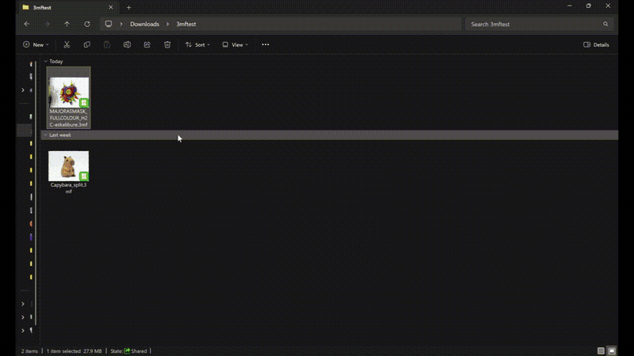

# QuickLook.Plugin.ThreeMFViewer

Preview 3MF and Bambu Studio files without opening a slicer: select a `.3mf`, `.bambu` or `.bambustudio` file in Explorer, press Space, and turn the model around.

This is a plugin for [QuickLook](https://github.com/QL-Win/QuickLook), the free app that brings macOS-style Quick Look to Windows. With it, the model opens in full colour, using the filament colours saved in the file.

## What it shows

- The model in the colours stored by Bambu Studio, including painted regions
- Rotate, pan and zoom with the mouse (see Controls below)
- If the file has a preview picture, a button switches between the picture and the 3D model
- While a big file loads, the window title shows how many triangles have been read

## Large files

Very detailed models are simplified a little so they open quickly, and the info line says "simplified for preview". A 28 MB multi-colour file opened in about 5 seconds on the author's PC. A big model can use around 1 GB while the preview is open. After you close it, the plugin trims QuickLook's memory back towards its normal size; the preview's graphics memory is fully released the next time you preview something.

## Install

Download `QuickLook.Plugin.ThreeMFViewer.qlplugin` from Releases, select it in Explorer, press Space, click Install, then restart QuickLook. Tested on QuickLook 4.5.0 (Microsoft Store version).

## Build

1. Open `QuickLook.Plugin.ThreeMFViewer.sln` in Visual Studio and build the **Release** configuration, or run `dotnet build QuickLook.Plugin.ThreeMFViewer.sln -c Release` from this directory.
2. Run `Scripts\pack-zip.ps1` from this directory to create `QuickLook.Plugin.ThreeMFViewer.qlplugin`.
3. In QuickLook, open the `.qlplugin` package and install it, then restart QuickLook.

The project targets .NET Framework 4.6.2 and uses WPF and HelixToolkit.Wpf.

## Controls

- Left-drag: rotate the model around its centre
- Right-drag: pan the model across the viewport
- Scroll wheel: zoom
- When an embedded image exists, use **Show image** / **Show 3D model** to switch views; scroll to zoom the image.

## Offline harness

Build `harness\QL3MFHarness.csproj` and run `QL3MFHarness <file.3mf> <out.png>` to render a local test file to PNG.

## If something goes wrong

The plugin keeps a small log of what it did in `%TEMP%\QuickLook.ThreeMFViewer.trap.log` (paste that into the Explorer address bar to open the folder). It records the file type and size, the steps taken and any errors, but not the path of the file you opened. If a preview fails, attach this file to an issue and it will show what happened.

## Licence

See `LICENSE.txt` for this plugin's licence. `QuickLook.Common` includes its own licence file.
